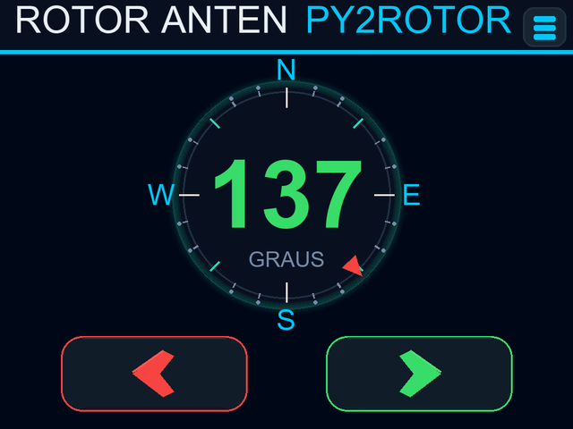
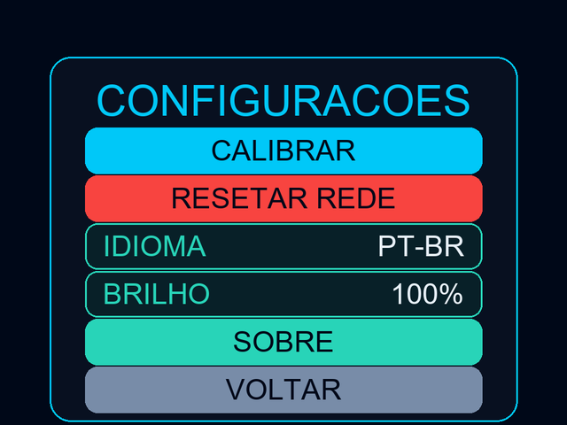
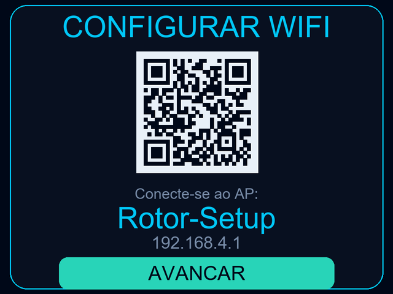

# Rotor CYD

Controlador de rotor de antena baseado em **ESP32-2432S028R (CYD 2USB, display ST7789)**,
com interface touch feita em **LovyanGFX** e portal de configuração via **WiFiManager**.
O azimute vem de um potenciômetro no ADC e dois relés comutam os motores horário e
anti-horário.

> O repositório é genérico: indicativo, nome, SSID e endereço IP são apenas
> valores de exemplo ou ficam gravados no dispositivo. Veja
> [Personalização](#personalização) para ajustar ao seu uso.

---

## Prévia da interface

Representação digital gerada a partir das mesmas constantes de desenho do firmware
(`src/ui/hmi.cpp`). A versão em `docs/` está na resolução nativa (320×240) e a
versão `@2x` (640×480) é a usada aqui e no instalador web:

| Tela principal | Configurações |
|---|---|
|  |  |

Tela exibida quando o Access Point de configuração está ativo:



> As imagens são uma reconstrução vetorial/raster fiel ao código de desenho, não
> uma foto do display físico. Para gerá-las novamente:
> `pip install pillow && python scripts/render_preview.py`.

---

## Funcionalidades

- **Bússola centralizada** com número do azimute em fonte VLW anti-aliada de 48 px,
  agulha vermelha, marcadores em três níveis e halo suave.
- **Controle por toque** com botões CCW/CW e watchdog de 1,2 s para comandos via web.
- **Portal web responsivo** com três abas: `Inicio`, `Configurar` e `Rede`.
- **Configurações persistidas** em NVS: nome da antena, indicativo, paleta, idioma e
  brilho.
- **Cinco paletas de cores** aplicadas em tempo real no CYD.
- **Idioma PT-BR / EN** com tradução completa da interface do CYD.
- **Ajuste de brilho** de 10% a 100%, em passos de 10%.
- **QR Code do Access Point** na tela do CYD quando não há Wi-Fi configurado, com o
  nome da rede e um botão **Avançar** que explica onde configurar o Wi-Fi.
- **Aviso de Wi-Fi indisponível**: se a rede salva falhar no boot, se a senha estiver
  errada ou se a conexão cair, o CYD mostra um popup com o nome da rede e oferece
  **TROCAR** (abre o QR do AP) ou **OK**.
- **Calibration touch** horizontal, salva na flash, executada apenas no primeiro boot,
  após reset de rede ou pelo menu `CALIBRAR`.
- **Segurança no motor**: relés mutuamente exclusivos, ativos em LOW, com corte
  automático após 60 s de comando contínuo.

---

## Hardware

O esquema completo de ligação está em [`docs/esquema.md`](docs/esquema.md) e o
diagrama vetorial em [`docs/esquema.svg`](docs/esquema.svg).

### Pinos principais

| Função | GPIO |
|---|---|
| Display SCLK / MOSI / MISO | 14 / 13 / 12 (HSPI) |
| Display DC / CS / Backlight | 2 / 15 / 21 |
| Touch SCLK / MOSI / MISO / CS | 25 / 32 / 39 / 33 (VSPI) |
| Touch IRQ | 36 (desativado: `cfg.pin_int = -1`, evita toques fantasmas) |
| Potenciômetro (wiper) | 34 (ADC1) |
| Relé CW / CCW | 22 / 27 (ativos em LOW) |

### Potenciômetro

- Linear de 10 kΩ, alimentado por 3V3/GND.
- `100 ≈ 0°`, `3900 ≈ 360°` (ajustável em `src/main.cpp`).
- Média de 10 leituras e filtro exponencial no display.

---

## Compilação e gravação

Requisitos: [PlatformIO](https://platformio.org/) e Python (para o gerador do QR).

```powershell
# compilar
pio run -e cyd

# gravar (substitua COM4 pela sua porta)
pio run -e cyd -t upload --upload-port COM4

# monitor serial
pio device monitor -e cyd
```

As fontes VLW são incorporadas ao binário via `board_build.embed_files` em
`platformio.ini` — não é necessário SPIFFS para elas.

### Instalação pelo navegador (flasher web)

**https://arturaugustoms.github.io/rotor-cyd/**

Conecte o CYD por USB e clique em **Instalar / Atualizar**. O instalador usa
[ESP Web Tools](https://esphome.github.io/esp-web-tools/) e grava bootloader,
tabela de partições e firmware de uma vez — sem PlatformIO, esptool ou drivers
de gravação.

O site é publicado no **GitHub Pages** (hospedagem gratuita) pelo workflow
[`.github/workflows/flasher.yml`](.github/workflows/flasher.yml). Ele recompila o
firmware e atualiza o `manifest.json` **automaticamente a cada push em `main`**
(nas Releases, usa o nome da tag como versão). Para testar sem esperar o CI:

```powershell
pio run -e cyd
python scripts/make_flasher.py   # gera a pasta site/ com os binários e o manifest
```

Requisitos: HTTPS (o GitHub Pages já fornece) e navegador com Web Serial —
Chrome, Edge ou Chrome para Android. Safari e Firefox não funcionam.

### Gravação manual

Os binários também estão em `site/firmware/` no Pages e podem ser baixados.
Endereços de gravação:

| Arquivo | Endereço |
|---|---|
| `bootloader.bin` | `0x1000` |
| `partitions.bin` | `0x8000` |
| `boot_app0.bin` | `0xE000` |
| `firmware.bin` | `0x10000` |

```powershell
python -m esptool --chip esp32 --port COM4 --baud 921600 write_flash `
  0x1000 bootloader.bin 0x8000 partitions.bin 0xe000 boot_app0.bin 0x10000 firmware.bin
```

Como as fontes VLW estão embutidas, **não** é preciso publicar ou gravar
conteúdo SPIFFS/LittleFS.

---

## Primeira inicialização

1. Na primeira vez, a tela pede a calibração do touch: toque e segure cada um dos
   4 alvos em sentido horário.
2. Os parâmetros são salvos na flash (namespace `rotor_cal`, com checksum) e
   reaplicados nos bootings seguintes.
3. Para refazer: menu de configurações → `CALIBRAR`.
4. Para apagar tudo de rede: `RESETAR REDE` → `CONFIRMAR`. Isso também limpa a
   calibração e reinicia o ESP32.

---

## Configuração do Wi-Fi

Sem uma rede salva, o WiFiManager sobe um Access Point aberto chamado
`Rotor-Setup` em `192.168.4.1` e a tela do CYD mostra:

- um **QR Code** no formato `WIFI:T:nopass;S:Rotor-Setup;;`;
- o **nome da rede** abaixo dele;
- o botão **AVANÇAR**, que abre um aviso para configurar o Wi-Fi na aba `Rede`
  do site.

No celular: escaneie o QR, conecte-se ao AP, abra `http://192.168.4.1` e preencha
a rede desejada. O nome da rede fica gravado no ESP32 e é usado automaticamente
nos próximos boots. Com Wi-Fi conectado, a tela do CYD volta à bússola.

Se o mDNS estiver disponível, o portal também responde em `http://rotor-cyd.local`.

### Quando o Wi-Fi falha

- **Rede salva não encontrada no boot / senha inválida:** o CYD exibe o popup
  `AVISO WI-FI` com o nome da rede. Toque em **TROCAR** para abrir o AP e escanear o
  QR, ou em **OK** para apenas dispensar. A tela do QR continua disponível.
- **Conexão perdida depois de conectado:** após 10 s sem rede, o mesmo popup aparece
  com `Conexao Wi-Fi perdida`. O firmware continua tentando reconectar a cada 15 s;
  se voltar, o aviso desaparece sozinho.
- **Erro ao salvar uma rede pelo site:** após 20 s sem conectividade, o popup informa
  a rede que falhou.

---

## Portal web

| Página | Conteúdo |
|---|---|
| `/` | Bússola, azimute e botões de rotação (hold para girar) |
| `/settings` | Nome da antena, indicativo, paleta e quadro "Sobre" |
| `/rede` | Rede conectada, SSID/senha e lista de redes com sinal e cadeado |

### API

| Método | Rota | Descrição |
|---|---|---|
| GET | `/api/state` | Azimute, nome/indicativo, paleta, versão, Wi-Fi e comando atual |
| POST | `/api/settings` | Salva `antenna` e `callsign` |
| POST | `/api/rotate` | Comando de rotação (`dir`: -1, 0 ou +1) |
| POST | `/api/wifi` | Salva e conecta em `ssid`/`password` |
| GET | `/api/wifi/scan` | Varredura assíncrona (use `?force=1` para forçar) |
| POST | `/api/palette` | Troca a paleta do CYD |

Exemplo:

```bash
curl -s http://rotor-cyd.local/api/state
```

O comando de rotação enviado pela web expira após 1,2 s. Os botões de hold
reenviam `dir` a cada ~400 ms enquanto pressionados.

---

## Configurações no CYD

Toque no ícone de três riscos no canto superior direito:

| Opção | Função |
|---|---|
| `CALIBRAR` | Refaz a calibração do touch (4 alvos) |
| `RESETAR REDE` | Apaga Wi-Fi e calibração, reinicia o aparelho |
| `IDIOMA` | Alterna PT-BR ↔ EN |
| `BRILHO` | Ajusta o brilho em passos de 10% |
| `SOBRE` | Indicativo, nome, data, ano e versão do firmware |
| `VOLTAR` | Retorna à tela principal |

---

## Estrutura do projeto

```
include/
  config.h                 pinos, versão, constantes gerais
  web_pages.h              HTML/CSS/JS do portal
  hardware/
    display_font.h         índices das fontes VLW
    lgfx_rotor.hpp         configuração ST7789 + XPT2046
    ap_qr.h                bitmap do QR do AP
  services/
    settings.h             estrutura persistida
src/
  main.cpp                 setup/loop e integração com WiFiManager
  hardware/
    motor.cpp              relés e watchdog de segurança
    display_font.cpp       carregamento das fontes
    font_blobs.cpp         símbolos dos blobs incorporados
    ap_qr.cpp              bitmap do QR
  services/
    web_portal.cpp         rotas e APIs HTTP
    settings.cpp           NVS (rotor)
    rotor_state.cpp        azimute e watchdog de comando web
    calibration.cpp        NVS (rotor_cal)
  ui/hmi.cpp               desenho, touch e telas do CYD
data/*.vlw                 fontes VLW incorporadas
docs/                      esquema elétrico
scripts/gen_ap_qr.py       gerador do bitmap do QR
scripts/render_preview.py  gera as imagens das telas para o README
scripts/make_flasher.py    monta o site/manifest do instalador web
.github/workflows/flasher.yml  publica o instalador no GitHub Pages
flasher/index.html         página do instalador (ESP Web Tools)
```

---

## Personalização

Edite `include/config.h` antes de compilar:

```cpp
constexpr char kFirmwareVersion[] = "1.1-rotor-web";
constexpr char kPortalApName[]    = "Rotor-Setup";
constexpr char kPortalHostname[]  = "rotor-cyd";
constexpr char kOwnerCallsign[]   = "PY0XXX";   // padrão de "Sobre"
constexpr char kOwnerName[]       = "Seu Nome"; // padrão de "Sobre"
```

Indicativo, nome da antena e os dados do quadro **Sobre** são salvos no NVS e
podem ser alterados pela aba `Configurar` do site, sem recompilar. Os valores em
`config.h` só são usados na primeira inicialização.

Se mudar `kPortalApName`, rode `python scripts/gen_ap_qr.py` e recompile para
atualizar o QR exibido na tela.

Os limites do potenciômetro estão em `src/main.cpp` (`kAdcMin` / `kAdcMax`).

---

## Fontes e licenças

As fontes VLW em `data/` são anti-aliadas e derivadas de fontes tipo Noto Sans.
`font_num.vlw` é um recorte dos dígitos de `font_xl.vlw` ampliado com interpolação
bicúbica para manter as bordas suaves quando exibido em escala 1:1. Verifique a
licença das fontes antes de redistribuir o projeto.

As dependências são gerenciadas pelo PlatformIO: LovyanGFX, WiFiManager,
ArduinoJson e Preferences.

---

## Solução de problemas

| Sintoma | Verificação |
|---|---|
| Touch desalinhado | Refaça `CALIBRAR` no menu |
| Toques fantasmas | Confirme `cfg.pin_int = -1` em `lgfx_rotor.hpp` |
| Motor não para | Confira o watchdog de 60 s em `motor.cpp` e a lógica ativa-low |
| Wi-Fi não conecta | Observe o popup `AVISO WI-FI`: **TROCAR** abre o QR do AP; depois configure na aba `Rede` |
| Aviso de Wi-Fi não some | Ele fecha sozinho quando a conexão volta; caso contrário toque em **OK** ou use `RESETAR REDE` |
| QR não aparece | O QR só aparece quando o portal AP está ativo (sem rede salva) |
| Fonte com "degraus" | Use `uiFont(kDigitFontIndex)` em escala 1, sem `setTextSize()` |
